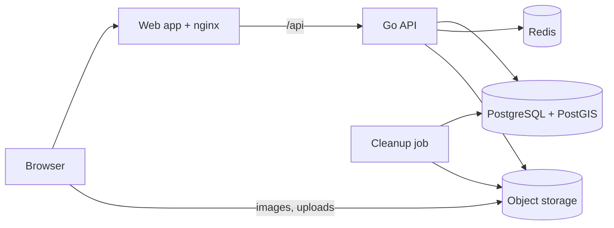

# SakuKota

A hyper-local "survival map" for people who have just moved to Jakarta for work. It puts curated, budget-friendly everyday essentials on one map next to practical information about each kecamatan (district): flood history, safety, and what a day costs.

---

## 🚨 Disclaimer

This project was created for learning and portfolio purposes only. It is not affiliated with any company, client, or organization. All names, data, and assets used in this project are fictionalized or sanitized for public use.

---

## 🧩 Problem Statement

- **Background:** Every year many fresh graduates, trainees, and young professionals move to Jakarta for work (_merantau_). They arrive with a tight budget and no local knowledge.
- **Problem:** Mainstream map apps favour restaurants and large businesses, so the places a newcomer needs most (a cheap warung, a tailor, a laundry, a clinic, a pharmacy) are missing, inaccurate, or buried. Newcomers also know little about their new neighbourhood: whether it floods, whether it is safe, and how much daily life costs. Today they rely on trial and error and word of mouth.
- **Goal:** Give newcomers one place to find reliable everyday essentials nearby and to judge whether an area suits them, using admin-verified data instead of unverified volume.
- **Why it matters to me:** As a newcomer to Jakarta myself, I found it hard to find important places around me. SakuKota is the map I wish I had when I arrived.

---

## 🎯 Project Objectives

- Provide users with a map of curated essentials that they can filter by category and search by keyword, with the map, list, and result count kept in sync.
- Show flood history, safety information, and estimated daily spending for each kecamatan.
- Let signed-in users contribute by rating and reviewing places, suggesting missing ones, and reporting abusive content.
- Enable admins to verify every suggestion before it appears, manage places and their photos, and resolve reports.
- Stay usable one-handed on a phone and show missing data honestly instead of hiding or inventing it.

---

## 💡 Solution Overview

SakuKota is a single-page web app backed by a Go REST API. Visitors open the map, pick a kecamatan, filter by category or search, and tap a pin to see its address, opening hours, price range, description, photos, category-specific details (for example a warung's halal status or a laundry's turnaround time), rating, and reviews. A kecamatan's information panel shows its flood, safety, and spending information, and its boundary is outlined on the map.

Contributions go through an admin. A signed-in user can review a place once, suggest up to five places at a time, and report abusive places or reviews. An administrator approves or rejects each suggestion (correcting its details first) and removes or dismisses each report. Constraints and assumptions: the sample data covers three kecamatan (Setiabudi, Mampang Prapatan, and Tebet), kost (boarding-house) listings are deliberately out of scope, and the interface is in Bahasa Indonesia.

---

## 🛠 Tech Stack

- **Backend:** Go, chi router, sqlx, goose migrations, JWT (HS256) with argon2id password hashing
- **Frontend:** React 19, TypeScript, Vite, TanStack Router, Query, and Form, Zod, Tailwind CSS v4, Base UI, Leaflet
- **Database & storage:** PostgreSQL 17 with PostGIS, Redis, S3-compatible object storage (Garage)
- **Infrastructure / DevOps:** Docker / Podman Compose, nginx, OpenTelemetry with Prometheus, Grafana, Tempo, and Loki
- **Testing & Quality:** Go `testing` with testify and gomock, testcontainers for repository tests, Vitest, ESLint, Prettier, k6 for load tests
- **Other Tools:** Makefile, air (live reload), OpenAPI with a Scalar reference page

---

## 🧱 System Architecture

The browser loads the web app, which calls the API under `/api` on the same origin. nginx (or the Vite dev proxy) forwards those calls to the Go API under `/v1`. The API is a layered, domain-modular monolith: each domain (`auth`, `users`, `places`, `reviews`, `reports`, `subdistricts`, `suggestions`) has its own handler, service, and repository. PostgreSQL with PostGIS stores the data and answers "places inside this map view" queries. Redis holds refresh tokens and a short-lived cache of place lists. Images and videos are uploaded by the browser directly to object storage through presigned URLs, so the API never receives file bytes. A separate cleanup job deletes files that are no longer used.



Map tiles come from Esri and OpenStreetMap through Leaflet.

---

## ✨ Features

Core:

- **Survival map** – pins for 16 categories of essentials, grouped by color, loaded for the visible map area.
- **Place details** – address, hours, price range, description, photos, category-specific details, average rating, and reviews.
- **Kecamatan information** – flood history, safety, estimated daily spending, photos, and a boundary outline on the map.
- **Category filter and search** – multi-select categories and keyword search, kept in sync with the map. The view lives in the URL, so it can be shared as a link.

Beyond the original scope:

- **Accounts** – sign up and sign in, with sessions that survive a page reload.
- **Reviews** – 1 to 5 stars with an optional comment and photos, one per user per place.
- **Place suggestions** – a form with a map picker; users follow each suggestion's status and see the reason for a rejection.
- **Abuse reports** – users report places or reviews; admins remove the content or dismiss the report.
- **Admin area** – manage places and their photos and videos, review suggestions, and resolve reports.
- **My location** – center the map on the user's position.

---

## 🚀 Getting Started

### Prerequisites

- Go 1.27 or newer
- Node.js LTS and pnpm
- Docker with Compose, or Podman with `podman compose` (set `CONTAINER_ENGINE=podman` in `.env`)
- [air](https://github.com/air-verse/air) for live reload: `go install github.com/air-verse/air@latest`

PostgreSQL, Redis, and object storage run in containers, so they do not need to be installed.

### Installation

```bash
# 1. Clone the repository
git clone https://github.com/LinCie/SakuKota.git
cd SakuKota

# 2. Install dependencies
# Backend
go mod download

# Frontend
cd web && pnpm install && cd ..
```

### Configuration

Copy the example file and edit it. It contains only local development values.

```bash
cp .env.example .env
```

- `JWT_SECRET` – signs access tokens; replace it with a random string of at least 32 bytes.
- `DATABASE_URL` – PostgreSQL connection string; `POSTGRES_DB`, `POSTGRES_USER`, `POSTGRES_PASSWORD` configure the container.
- `REDIS_URL` – Redis connection string.
- `PORT` – port for the API (default `8080`).
- `CORS_ALLOWED_ORIGIN` – origin of the web app, allowed by the image bucket's CORS rule.
- `COOKIE_SECURE` – set to `false` only for local development over plain HTTP.
- `STORAGE_*` – object storage endpoint, bucket, and key pair. The example key pair only works with the local storage container; use your own secrets anywhere else.

### Running the Application

```bash
# Start PostgreSQL, Redis, and object storage
make postgres-up
make redis-up
make storage-up
make storage-init

# Apply migrations and, optionally, load sample data
make migrate-up
make seed

# Run the API and the web app together with live reload
make dev
```

The web app is served at `http://localhost:5173` and the API at `http://localhost:8080`. The API reference is at `http://localhost:8080/docs`.

To run the whole stack in containers instead:

```bash
docker compose up -d --build
docker compose run --rm --entrypoint /app/seed api   # optional sample data
```

The web app is then served at `http://localhost:8081` (`WEB_PORT` in `.env`).

The sample data includes an admin account (`admin@sakukota.go` / `admin123`) and demo users such as `dimas@sakukota.go` (password `sakukota123`).

Replaced or deleted images are queued for deletion. Run the cleanup job on a schedule, for example every 15 minutes from cron:

```bash
*/15 * * * * cd /path/to/SakuKota && make cleanup
```

---

## 🧪 Testing

```bash
# Backend unit tests (no database needed)
make test

# Backend unit and repository tests; starts PostgreSQL with testcontainers, so Docker must be running
make test-integration

# Frontend tests, type check, and lint
cd web
pnpm test
pnpm typecheck
pnpm lint
```

Backend unit tests cover handlers and services with generated mocks. The integration tests run the repositories and transactional workflows (suggestion approval, review and report handling, storage cleanup) against a real PostgreSQL database. Frontend tests cover form schemas, data mappers, the session, the API client, and image uploads.

---

## 🗂 Project Structure

```text
.
├── cmd/
│   ├── api/          # HTTP API server
│   ├── migrate/      # Database migrations (goose)
│   ├── seed/         # Sample data
│   ├── seed-bulk/    # 50,000 places for load tests
│   └── cleanup/      # Deletes queued storage objects
├── internal/
│   ├── module/       # One package per domain: handler, service, repository
│   ├── domain/       # Shared domain types and errors
│   ├── middleware/   # Auth, role guard, logging, telemetry, body limit
│   ├── router/       # Route wiring
│   ├── storage/      # Presigned uploads and media handling
│   ├── database/     # PostgreSQL, Redis, transactions
│   └── docs/         # OpenAPI spec and reference page
├── migrations/       # SQL migrations
├── web/              # React frontend
├── docker/           # Dockerfiles and service configuration
├── nginx/            # Reverse proxy configuration for deployment
├── scripts/          # Load test and profiling scripts
└── docs/             # Product, backend, and frontend documentation
```

---

## 📚 Implementation Details

The tested backend contract, rule by rule, is in [docs/CONTEXT.md](docs/CONTEXT.md). The full route reference is the OpenAPI spec served at `/docs`.

### Domain & Data Modeling

- **Places** belong to a **kecamatan** (`SUB_DISTRICTS`) and a **category**. Each place has a PostGIS location, so map queries use a spatial index.
- **Categories** and their custom **fields** (`CATEGORY_FIELDS`) are defined in migrations. A place's values for those fields are stored as JSONB in `PLACES.attributes` and validated by the service.
- **Users** write **reviews** (`PLACE_REVIEWS`), **suggestions** (`PLACE_SUGGESTIONS`), and **reports** (`REPORTS`).
- **Medias** (images and videos) attach to places, kecamatan, and reviews through join tables. A place or kecamatan can have at most 10.
- Rules are enforced by the database: unique emails and kecamatan names, one review per user per place, and a limit on pending suggestions and reports.

### API Design

- REST endpoints under `/v1` for auth, places, categories, reviews, kecamatan, suggestions, and reports, documented with OpenAPI at `/docs`.
- Every success body is `{"data": ...}` and every error body is `{"code": "...", "message": "..."}` with a stable code that clients branch on (for example `VALIDATION_ERROR`, `ALREADY_REVIEWED`, `TOO_MANY_PENDING_SUGGESTIONS`).
- `GET /places` supports kecamatan, category, keyword, and bounding-box filters with paging. With a bounding box, results are ordered by distance from its center.

### Notable Design Decisions

- **Layered, domain-modular monolith.** Handlers decode requests and map errors, services hold business rules, and repositories contain only SQL. Handlers and services are unit-tested with generated mocks; repositories are tested against a real database.
- **Short-lived access tokens with rotating refresh tokens.** Access tokens last 5 minutes. Refresh tokens live in an `HttpOnly` cookie, are stored only as SHA-256 hashes in Redis, and work once.
- **Conflicts decided by the database.** Uniqueness and limits are constraints or `WHERE` conditions, mapped to domain errors, so concurrent requests cannot race past a check in Go.
- **Rating totals on the place row.** `rating_count` and `rating_sum` are updated in the same statement that inserts a review, so listing 100 places never runs `AVG()`.
- **Transactional outbox for file deletion.** Deleting a row queues its storage keys in the same transaction, and a separate job deletes the files with retries. A failed storage call never leaves a row pointing at a missing file.
- **Direct-to-storage uploads.** The browser uploads through presigned URLs. The API only checks each file's real type and size before attaching it, so a 1 MiB request body limit applies to every route.

---

## 🔍 Limitations & Future Improvements

- Only three kecamatan are seeded. Many place details in the sample data are generated, so it is for demonstration, not real decisions.
- The admin area has no screens for kecamatan yet; they are managed through the API.
- Pins crowd together when a whole kecamatan is in view; clustering would help.
- Reviews cannot be edited, and suggestions cannot include photos.
- There is no password reset or email verification.
- The interface is in Bahasa Indonesia only, and the sample content is mostly in English.
- The app has not yet been tested with real newcomers.

---

## 👤 Author

- Name: Aldio Fernanda
- GitHub: [@LinCie](https://github.com/LinCie)

---

## 📄 License

This project is licensed under the GNU Affero General Public License v3.0 — see the [LICENSE](LICENSE) file for details.
